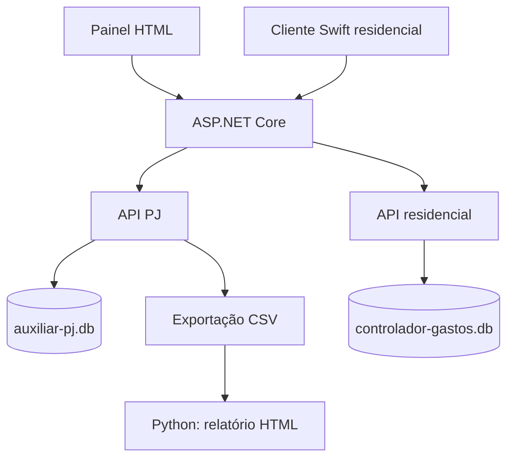

# Auxiliar PJ

Sistema local de gestão financeira para profissionais PJ, freelancers e pequenas empresas, com um módulo legado de controle residencial.

[](https://github.com/juniordev830/auxiliar-NF-pj/actions/workflows/ci.yml)

> **Status:** protótipo em desenvolvimento, restrito ao computador local. Use dados fictícios. Não emite notas fiscais (NFS-e/NF-e), não calcula tributos e não está pronto para produção.

## Funcionalidades

| Módulo | Recursos atuais |
| --- | --- |
| Financeiro PJ | Receitas e despesas, categoria, cliente/fornecedor por lançamento, competência, vencimento e pagamento |
| Painel web | Resumo mensal, saldo previsto e realizado, filtro por status, paginação, registro e reabertura de pagamento, edição de lançamento, encerramento da sessão local, exportação CSV |
| Residencial | API para cadastro e exclusão de pessoas, transações, filtros e totais gerais e mensais |
| Relatórios | Conversão de CSV ou XLSX em HTML com indicadores e gráficos |
| Cliente Swift | Terminal experimental somente leitura para a API residencial |

O painel PJ permite editar lançamentos. A exclusão lógica e a consulta do histórico estão disponíveis pela API. O histórico registra alterações após a migração. O módulo residencial não possui interface web própria.

## Tecnologias e arquitetura

- C# / .NET 8, ASP.NET Core Minimal APIs e Entity Framework Core 8.
- SQLite: bancos separados para PJ e residencial.
- HTML, CSS e JavaScript nativos, servidos pela própria API; não é necessário Node.js, React ou Vite.
- Python, Pandas, openpyxl, Matplotlib e pytest para relatórios.
- Swift 5.9+ para o cliente de terminal opcional.
- GitHub Actions para compilação, auditoria de dependências e testes.



## Executar localmente

Pré-requisitos: Git e SDK .NET 8. Python e Swift são necessários somente para seus módulos opcionais.

```bash
git clone https://github.com/juniordev830/auxiliar-NF-pj.git
cd auxiliar-NF-pj
dotnet restore ControladorGastos/ControladorGastos.csproj
```

### Windows (PowerShell 5.1 ou superior)

```powershell
$rng = [System.Security.Cryptography.RandomNumberGenerator]::Create()
$bytes = New-Object byte[] 32
$rng.GetBytes($bytes)
$env:GASTOS_READ_TOKEN = [Convert]::ToBase64String($bytes)
$rng.GetBytes($bytes)
$env:GASTOS_ADMIN_TOKEN = [Convert]::ToBase64String($bytes)
$rng.Dispose()
dotnet run --project ControladorGastos/ControladorGastos.csproj
```

### Linux/macOS (shell com OpenSSL)

```bash
export GASTOS_READ_TOKEN="$(openssl rand -hex 32)"
export GASTOS_ADMIN_TOKEN="$(openssl rand -hex 32)"
dotnet run --project ControladorGastos/ControladorGastos.csproj
```

Abra [http://127.0.0.1:5000/](http://127.0.0.1:5000/) e informe o token de administração para cadastrar lançamentos. Para consultar o token local, antes de iniciar o servidor use `$env:GASTOS_ADMIN_TOKEN` no PowerShell ou `printf '%s\n' "$GASTOS_ADMIN_TOKEN"` no shell, em terminal privado. Não compartilhe o valor. Mantenha o servidor em execução.

O endpoint [de saúde](http://127.0.0.1:5000/api/health) retorna `{"status":"ok"}` sem autenticação. Para diagnóstico no Windows, execute `scripts\diagnosticar-conexao.cmd` a partir da raiz em outro terminal.

## API

Todas as rotas abaixo, exceto saúde, exigem o cabeçalho `Authorization: Bearer <token>`. O token leitor permite GET/HEAD; o administrador permite operações de escrita.

| Método | Rota | Descrição |
| --- | --- | --- |
| GET | /api/health | Disponibilidade |
| GET | /api/pj/resumo | Resumo por competência |
| GET | /api/pj/lancamentos | Listagem paginada e filtros |
| POST | /api/pj/lancamentos | Criar lançamento |
| PUT | /api/pj/lancamentos/{id}/pagamento | Registrar/reabrir pagamento |
| PUT | /api/pj/lancamentos/{id} | Editar lançamento |
| GET | /api/pj/lancamentos/{id}/historico | Histórico de alterações |
| DELETE | /api/pj/lancamentos/{id} | Exclusão lógica |
| GET | /api/pj/exportar.csv | Exportar lançamentos |
| GET | /api/pessoas | Listar pessoas |
| POST | /api/pessoas | Cadastrar pessoa |
| DELETE | /api/pessoas/{id} | Excluir pessoa e transações |
| GET | /api/transacoes | Listar transações residenciais |
| POST | /api/transacoes | Criar transação residencial |
| GET | /api/transacoes/totais/mensal | Totais por mês |
| GET | /api/transacoes/totais/resumo | Totais gerais e por pessoa |

Consulte os parâmetros, regras e exemplos na [documentação técnica](DOCUMENTACAO.md).

## Dados e segurança

A aplicação exige dois tokens diferentes, cada um com pelo menos 32 bytes UTF-8, e escuta exclusivamente em 127.0.0.1:5000. Requisições sem token válido retornam 401; um leitor tentando escrever recebe 403. O painel guarda o token apenas em memória, permite sair e limpa a sessão local após 15 minutos sem requisições. Isso não revoga o token do servidor.

Os bancos `controlador-gastos.db` e `auxiliar-pj.db` são independentes; não há transferência automática de dados residenciais para PJ. As migrações do EF Core são aplicadas na inicialização. Antes de atualizar, pare o servidor e faça backup dos dois bancos (e de eventuais arquivos auxiliares SQLite); confira os dados após reiniciar. Não exclua o banco para resolver falhas. Use o [guia de backup e recuperação](docs/BACKUP_E_RECUPERACAO.md).

O resumo PJ usa competência, não a data do movimento bancário. O saldo realizado considera os lançamentos da competência com data de pagamento preenchida; o atraso usa a data UTC do servidor.

## Relatórios e testes

Na raiz, com Python instalado:

```bash
python -m pip install -r relatorios/requirements.txt
python relatorios/gerar_relatorio.py relatorios/exemplo-pj.csv --saida relatorio-pj.html
python -m pytest relatorios/tests -q
dotnet build ControladorGastos/ControladorGastos.csproj
```

Abra o HTML gerado no navegador. Para usar lançamentos fictícios do painel, exporte CSV e informe o caminho desse arquivo ao script. Os totais do relatório usam centavos inteiros e exibem valores em reais; registros inválidos são sinalizados. Não versione relatórios ou CSV com dados pessoais.

Consulte [relatórios](relatorios/README.md), [cliente Swift](swift-client/README.md) e [validação técnica](docs/GUIA_DE_VALIDACAO.md). O CI cobre build, auditoria NuGet, migração de bancos legados, verificações básicas da API e testes Python; testes de integração mais amplos ainda são necessários.

## Estrutura

```text
ControladorGastos/
  Program.cs                  # API residencial, autenticação, startup
  Data/                       # Contexto residencial e migrações
  Models/                     # Pessoas e transações
  PJ/                         # Contexto, entidades, endpoints e migrações PJ
  wwwroot/                     # Painel web PJ (HTML, CSS, JS)
relatorios/                   # Gerador Python, exemplo e testes
swift-client/                 # Cliente CLI e testes Swift
tests/                        # Regressão de atualização SQLite
scripts/                      # Diagnóstico Windows
docs/                         # Guia de validação
.github/workflows/            # CI
```

## Documentação

- [Guia rápido](GUIA_RAPIDO.md)
- [Documentação técnica](DOCUMENTACAO.md)
- [Configuração do VS Code](VSCODE_SETUP.md)
- [Validação e manutenção](docs/GUIA_DE_VALIDACAO.md)
- [Edição e histórico PJ](docs/API_PJ_AUDITORIA.md)
- [Backup e recuperação](docs/BACKUP_E_RECUPERACAO.md)
- [Revisão de segurança](docs/REVISAO_SEGURANCA.md)

## Próximos passos

Autenticação individual, autorização por empresa e recurso, backup/recuperação, auditoria, testes de integração e revisão de segurança antes de uso profissional. Cadastro de CNPJ, emissão fiscal, impostos e integração bancária são possibilidades futuras, não funcionalidades existentes. Funções fiscais exigem validação contábil.

O módulo de relatórios foi incorporado de [relatorio-altomatizado-de-contas-](https://github.com/juniordev830/relatorio-altomatizado-de-contas-), preservando o repositório original.
